# Design and assembly

## Design overview

Four individual supports mount a commercially available kayak seat at two selectable seating heights. The set comprises a front left, front right, rear left and rear right support. Compatibility depends on the seat frame, feet and kayak mounting arrangement; the video demonstrates one reference installation.

The two R19 O-rings fit on the front seat-foot uprights. They act as stops between those uprights and the slides in the two front supports.

## Parts and tools

- One of each printed support: see the [bill of materials](BOM.md) for STL and STEP downloads.
- Four M6 × 35 mm hexagon socket head cap screws.
- Four M6 large-diameter flat washers (outside diameter approximately three times the hole diameter).
- Two R19 O-rings.
- A 5 mm hex key and a measuring tape.

Use one washer under each mounting screw head.

## Installation

### 1. Record the original seat position

Before removing the seat, measure its usual fore-and-aft position relative to the pedal assembly. Use this measurement when positioning the first front support.

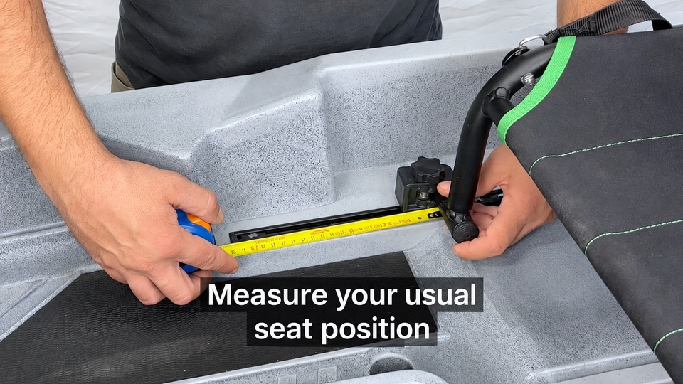

### 2. Remove the original supports

Lift out the seat and remove the original fittings from its feet as shown in the reference installation.

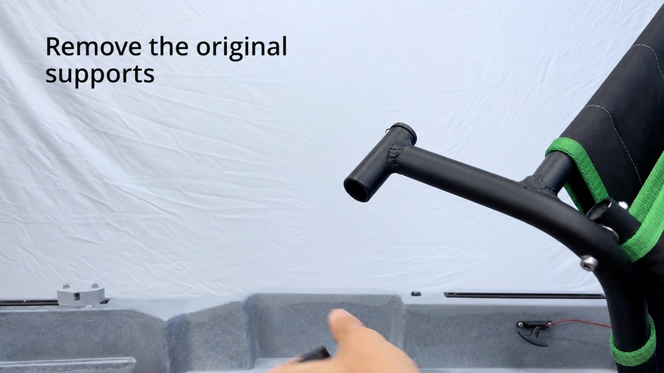

### 3. Fit the front O-rings

Slide one R19 O-ring onto each of the two front seat-foot uprights. Each ring forms a stop at the interface with its front support slide.

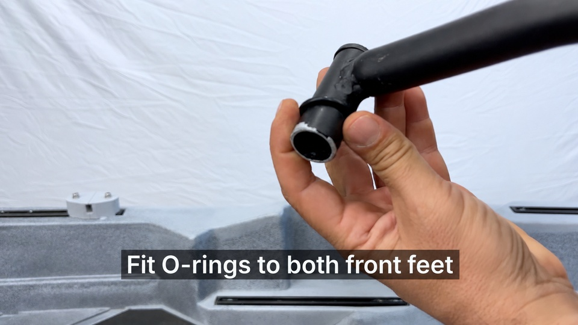

### 4. Position and secure the first front support

Mount one front support on the kayak rail using an M6 × 35 mm screw, one M6 large-diameter washer under its head, and the appropriate rail attachment hardware. Adjust its distance from the pedal assembly using the measurement recorded in step 1.

The reference video specifies a 5 mm hex key and a maximum tightening torque of 5 Nm. This is the limit shown for that installation; do not exceed a lower limit specified for the actual rail or mounting hardware.

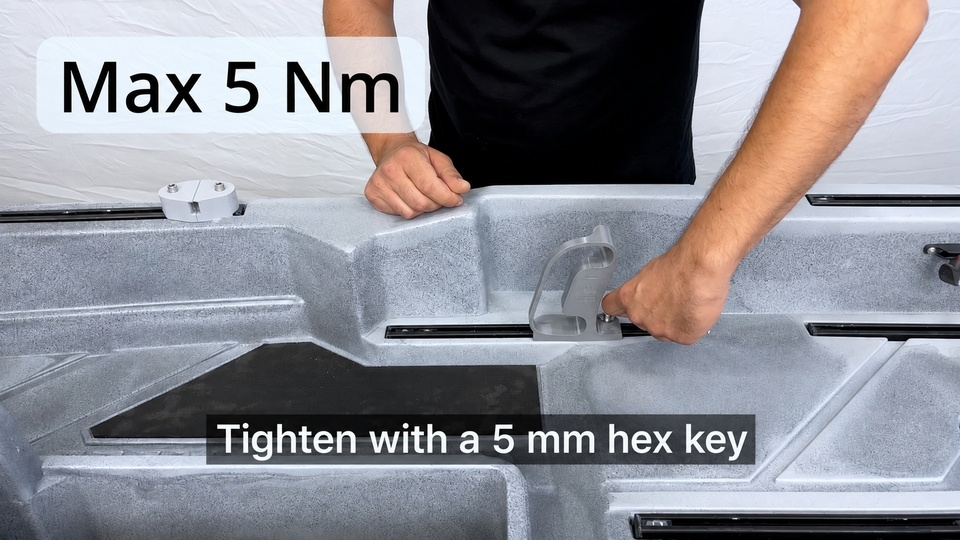

### 5. Align the second front support using the seat

Fit the second front support with its screw and washer, then place the seat in position to align it with the kayak and the opposite support. Secure the second support with the seat held in alignment.

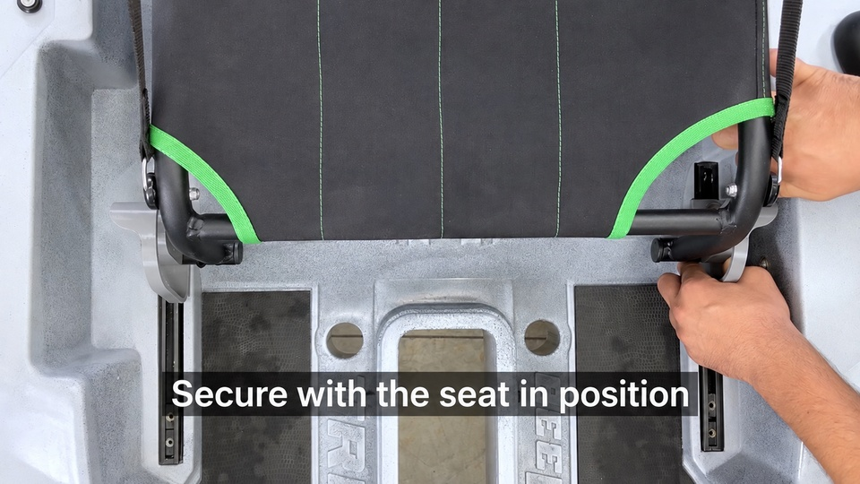

### 6. Position the rear supports

Fit the rear supports to their rails with the remaining M6 × 35 mm screws and washers. Initially leave them loose enough to slide along the rails.

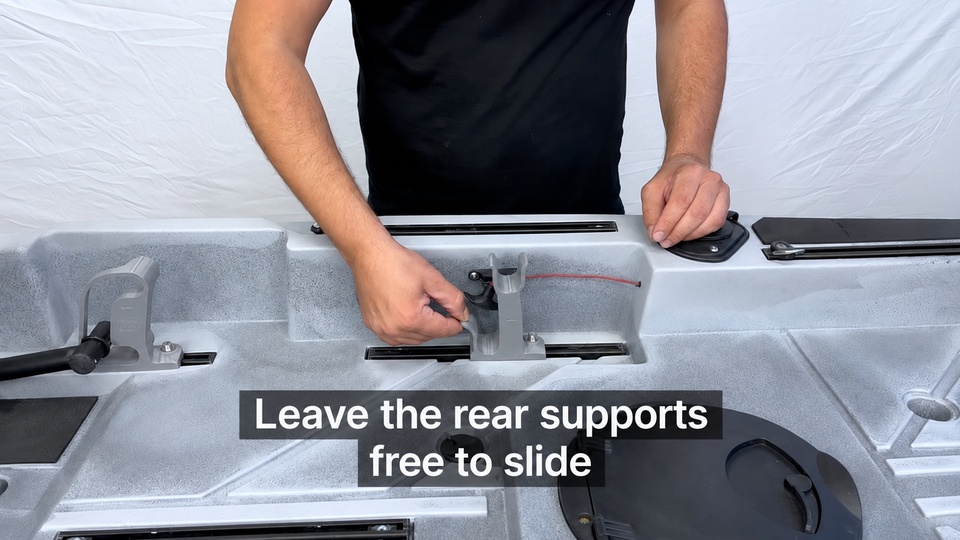

Place the seat in position, slide the rear supports into alignment with the rear seat feet, then tighten with the seat in position.

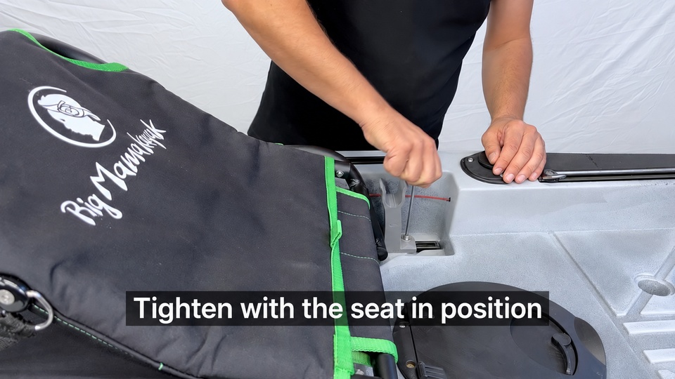

## Inserting and removing the seat

Start with the seat tipped forward toward the bow. Guide one front foot and its O-ring into the corresponding front support, sliding them fully against the stop.

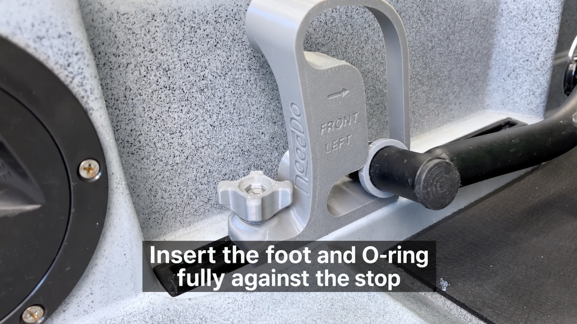

Angle the seat diagonally to pass the opposite front foot through the other support. The close-up below shows the foot passing through the support opening. Once both front feet are engaged, bring the seat back into its seating position and engage the rear feet in the corresponding rear seats.

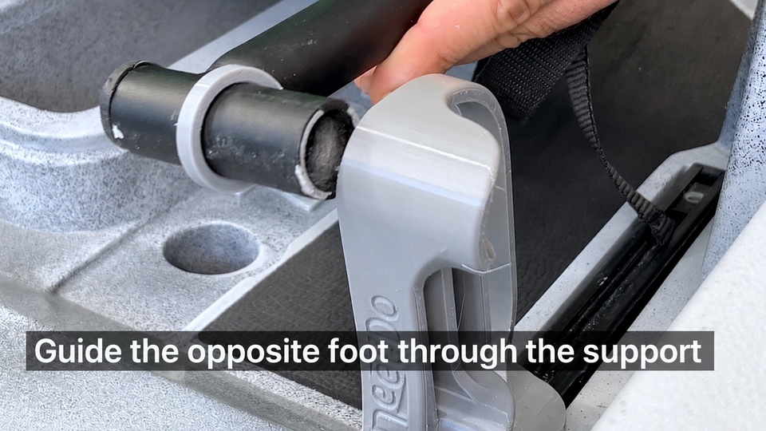

Remove the seat by reversing the insertion sequence.

## Two seating positions

The end of the video demonstrates the seat engaged in both the lower and raised positions. Check that all four feet are fully engaged in the corresponding support seats after repositioning.

### Lower position

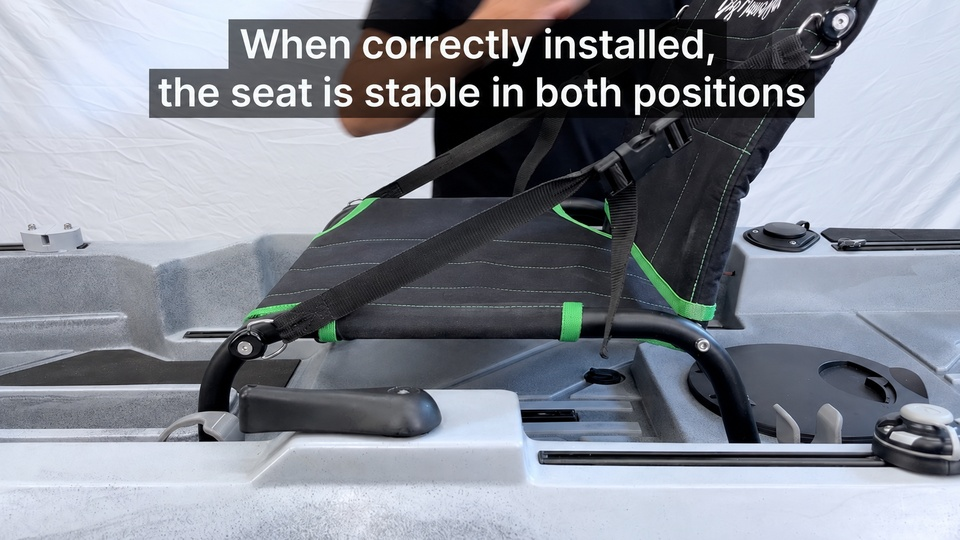

### Raised position

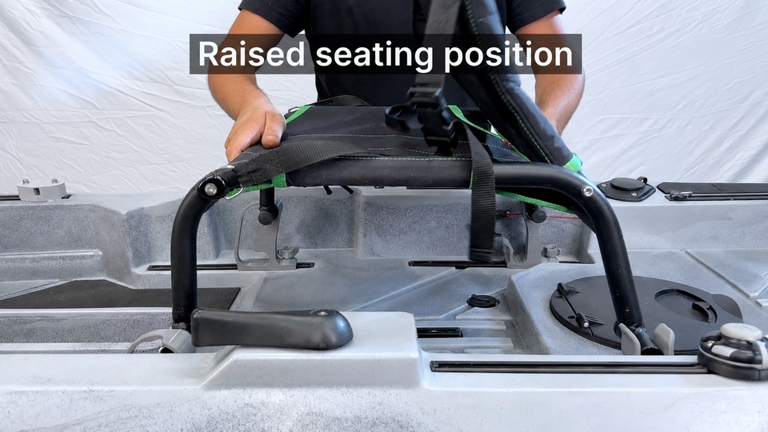

## Documentation basis

Instructions and still images are based on the supplied installation video (approximately 00:12–01:08). The original Italian captions have been replaced with English translations using image editing. The still images illustrate the installation sequence.

Exact seat compatibility, mounting dimensions, height difference remain to be confirmed for the published CAD revision.

For material, infill and annealing recommendations, see [3D printing recommendations](../README.md#3d-printing-recommendations).
